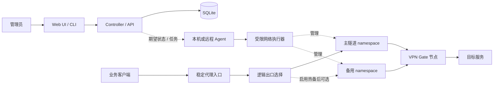

# Miku Gate 产品与技术规划

> 版本：提案 0.1 · 日期：2026-10-08 · 状态：已确认，实施中；当前实现范围见 PROGRESS.md。
>
> 本文中的能力、界面、版本和验收条件均为计划，不代表已有可运行产品。首版面向有授权的个人网络管理、开发测试和小团队使用。公共 VPN 节点不保证住宅属性、独享性、固定 IP、隐私、业务可达性或服务质量。

## 1. 产品定位与默认选择

**Miku Gate 是一个安全优先、可从单机扩展到多服务器的多出口代理管理平台。**

把不稳定的公共 VPN 节点封装成稳定的代理入口：入口地址和凭据可以长期不变，后台负责节点筛选、出口隔离、健康检测、换线和状态说明。

建议默认：

- 服务端：Debian 12 / Ubuntu 24.04，优先验证 amd64、arm64；Windows 用于开发和客户端，不作为首版网络服务端。
- 部署：原生 systemd 服务优先，不要求 Cloudflare，不引入 Kubernetes、Redis 或消息队列。
- 后端：Go；前端：React + TypeScript；存储：SQLite；隧道：官方 OpenVPN 客户端。
- 代理：每个出口一个 HTTP / SOCKS5 混合端口；首版支持 TCP，后续补 SOCKS5 UDP。
- 默认私有使用：管理界面和代理入口仅监听回环地址。开放到外网必须显式配置认证、访问范围和受保护的传输路径。
- UI：中文优先，青绿强调色、深浅主题、响应式布局；不预置未经授权的人物素材。
- 首版聚焦单机 3–5 个独立出口的功能验收；实际容量通过测试确定，不以槽位上限冒充性能承诺。

## 2. 三个参考项目：吸收什么，不照搬什么

| 参考 | 吸收的设计 | 明确改善 |
| --- | --- | --- |
| fanout | 多 namespace 出口、稳定端口、节点订阅、Xray 集成方向 | 增加 HTTP 入口；业务断线严格阻断；单独约束 DNS / IPv6；住宅判定不只依赖简单排除规则 |
| AimiliVPN | 候选节点检测、类型信息、缓存、切换预检、策略与诊断 | 多出口而非单一 tun0；连接失败与类型未知明确区分；DNS 不回退宿主解析 |
| Free-Residential-IP-Proxy-Controller | 控制端与 Agent 分离、多机状态和日志、集中配置 | 真正区分候选池与热备；独立设备身份；脚本不嵌入凭据；拒绝未鉴权配置分发；每台机器独立策略 |

现有参考快照：fanout `d7ce5224caf3469b19876982abdf8d1be16c4a8b`；AimiliVPN `e1ee381d0698928aab8e7a8d68df4aefa48b1c99`；Controller `e550df0439c53f8824ca2203cfa5fc5a02ea9785`。这些只作为设计依据，不是 Miku Gate 的功能或安全认证。

## 3. 先统一四个概念

| 概念 | 含义 | 例子 |
| --- | --- | --- |
| 候选节点 | 从上游发现的一条 VPN 配置及元数据 | 某个日本 VPN Gate 节点，可能未测试 |
| 隧道 | 实际运行的一条 OpenVPN 连接及其 namespace | 日本主隧道、日本预连接备用隧道 |
| 出口 | 用户长期管理的逻辑对象，有稳定 ID 和路由策略 | “日本开发环境”，可在候选节点之间切换 |
| 入口 | 客户端连接的端口、协议和凭据 | HTTP / SOCKS5 混合端口，或后续 Xray 入站 |

入口绑定逻辑出口，逻辑出口指向当前活动隧道。入口、逻辑出口和上游节点 ID 不混用。更换节点不删除重建用户的入口。

## 4. 用户操作流程

### 4.1 从零创建第一个出口

1. 执行安装预检，确认系统、TUN、权限、namespace、路由、防火墙和端口条件。
2. 本机领取一次性初始化凭据，设置管理员账号；远程管理使用 SSH 转发或 HTTPS。
3. 在“新建出口”选择国家、节点类型政策、监听范围和连接凭据。
4. 系统拉取并校验候选配置、进行受限并发测试，建立隔离网络与阻断规则。
5. OpenVPN 握手成功后，经隧道验证 DNS、出口 IP 和基本可达性。
6. 通过验证后才开放业务转发，生成 HTTP / SOCKS5 连接信息和测试方法。
7. 概览持续显示出口 IP、状态、测试时间、最近失败原因和保护状态。

### 4.2 同时使用多个国家

创建“日本开发”“韩国测试”“美国浏览”三个逻辑出口，各自独立端口、认证、namespace 与策略；一个出口失败不应修改另外两个出口的配置和宿主机默认路由。

### 4.3 手动换 IP

选择同地区新节点 → 预检 → 创建新隧道并验证 → 将新连接切到新隧道 → 回收旧隧道。无合格候选时保留健康旧连接并说明原因，不为了完成按钮动作强行换到坏节点。

入口保持不变，但旧连接不能跨公网 IP 自动迁移。健康旧隧道可按配置限时排空连接；故障旧隧道上的连接需要客户端重试。

### 4.4 上游断线

内核网络规则先阻止业务走宿主出口，健康检测再负责分类故障和恢复。所有候选不可用时显示“已阻断，等待恢复”，不静默直连，也不跨地区降级，除非用户显式配置跨地区回退。

## 5. 功能清单与版本边界

### 5.1 首版 v0.1：安全可用的单机多出口

| 功能组 | 计划内容 | 关键边界 |
| --- | --- | --- |
| 出口管理 | 新建、启停、删除、重命名、手动换节点、批量任务进度 | 入口地址和出口 ID 稳定；批量任务限制并发 |
| 混合代理 | 每出口 HTTP、HTTPS CONNECT、SOCKS5 TCP | HTTPS CONNECT 不等于代理入口本身开启 TLS |
| 认证与暴露控制 | 每入口随机凭据、来源 CIDR 白名单、连接数限制、端口冲突检查 | 默认回环监听；公网需用户显式开启并选择安全传输路径 |
| 网络隔离 | 每隧道独立 namespace、唯一接口命名、项目专属防火墙对象 | 不使用通用 tun0；不覆盖其他工具网络规则 |
| 断线保护 | fail-closed、仅允许规定的 VPN 底层通道、禁用业务直连回退 | 保护先于建连，不依赖每隔若干秒的巡检 |
| DNS / IPv6 | 业务域名通过指定隧道解析；失败直接报错；首版阻断业务 IPv6 | 控制端解析 VPN 端点的行为单独记录，不能成为业务 DNS 回退 |
| 节点发现 | VPN Gate 主源、显式配置的可信镜像、本地快照、来源及时间记录 | 旧快照不能直接标记为当前可用 |
| 配置校验 | OpenVPN 配置指令白名单、尺寸与内容限制、拒绝任意脚本和外部文件引用 | 不把下载到的配置直接当可信 root 指令执行 |
| 节点检测 | TCP 可达、OpenVPN 握手、DNS、实际出口 IP、受限目标探针 | 分层状态；不把列表 Ping 等同于本机延迟 |
| 基础分类 | 网络类型、代理标记、来源、查询时间、置信度；首个类型信息适配器 | 未知不当住宅；类型和信誉分开 |
| 选线策略 | 固定地区、固定节点、健康粘性、失败冷却、最近使用记录 | 固定节点失败不任意换国家；节点列表与实际出口 IP 分开存储 |
| 自动恢复 | 连续失败阈值、超时、退避、任务取消、重启状态恢复 | 探针不可靠时避免频繁切换；禁止无限重试风暴 |
| 可观测性 | 状态页、连接数、应用层流量计数、事件日志、失败原因 | 流量口径注明，不承诺与运营商计费一致 |
| 安装运维 | doctor / status / logs / backup、systemd 安装、范围受限卸载 | 不全局杀 OpenVPN，不清空系统日志，不改已有面板 |
| 安全管理 | 单管理员、密码哈希、安全会话、CSRF 防护、登录限速、脱敏日志 | 不设置人人相同的初始密码 |

### 5.2 v0.2：热备、客户端分发与体验完善

- 可选真实热备：每个启用热备的逻辑出口保持一条已连接、已验证的备用隧道。
- 热备只优化故障后新连接的恢复；旧 TCP / UDP 会话仍不能跨 IP 无损迁移。
- SOCKS5 UDP ASSOCIATE：关联绑定到认证 TCP 会话、来源校验、目标规则、空闲清理、缓冲及流量上限，避免成为开放 UDP 中继。
- Xray 原生适配：先支持小而明确的 VLESS / TLS 或 REALITY 组合，并有配置校验和进程隔离；其他协议与传输按实际需要添加。
- 按用户或设备生成客户端凭据、分享链接、可单独撤销的订阅 token。
- 订阅仅输出允许访问的出口，不泄露管理员或 Agent 身份；明确支持的客户端版本与格式。
- 增加第二类型信息来源、冲突展示、可选实际出口分类、资源预算内的带宽抽样。
- 收藏、标签、筛选视图、历史指标、可导出的脱敏诊断包。
- 完善原子更新、配置迁移检查、升级前备份和有前提的回滚；数据库迁移不兼容时不得只回滚二进制。

### 5.3 v0.3：多服务器集中管理

- 自托管 Controller + Agent；每台服务器拥有稳定设备 ID，不能用公网 IP 充当身份。
- Agent 出站建立受认证的 HTTPS 通道，不要求把特权管理端口直接开放到公网。
- 一次性短期注册令牌、单设备证书/密钥、轮换、吊销；管理员会话与设备凭据完全分离。
- 每服务器独立配置、出口策略、资源限额、标签与命令队列，允许显式批量下发。
- 声明式期望状态、配置版本、幂等操作、命令有效期和结果回报，阻止旧指令覆盖新状态。
- 中控离线时保留最后有效配置和本地自动恢复；首次注册、未授权变更与过期命令不放行。
- 权限区分管理员、运维和只读；按服务器/出口限制个人 API token。
- 心跳迟到不立即删除服务器；区分离线、状态过期、业务出口故障。

### 5.4 后续扩展，不纳入前三版硬承诺

- Cloudflare Access / Tunnel 等作为可选管理入口保护；不把业务代理流量默认引入 Cloudflare。
- Worker + D1 轻量控制端适配：先验证队列语义、配额、日志成本、注册安全和维护双后端的成本，再决定是否实现。
- 3x-ui 适配：优先只管理 Miku Gate 创建的对象；涉及共享 Xray 配置须备份、冲突检测和回滚。
- xray-cf-lite、其他节点提供方、用户拥有的 OpenVPN 配置；全部遵守同样的配置校验。
- WireGuard、完整双栈、独立 Windows 客户端等，按需求评估，不默认承诺。
- Docker 在隔离、能力边界和重启/卸载测试通过后再提供正式方案，不能把 host 网络容器描述成完整网络隔离。

## 6. 策略必须可解释

### 6.1 先过滤，再排序

先做硬过滤：用户允许的国家、网络类型政策、配置可信性、过期状态、黑名单、资源条件。通过后再比较连接成功率、近期失败、延迟、负载和历史表现。

不允许“分数高”绕过安全规则、显式国家约束或住宅严格模式。

### 6.2 三种类型政策

- 不限制：接受合格的住宅、移动或机房节点，仍显示实际分类。
- 住宅优先：优先住宅候选；允许其他类型时必须明确提示，不能偷偷降级。
- 严格住宅：仅接纳达到置信要求的住宅候选；未知、冲突或查询失败都不自动放行。移动网络另设选项。

严格住宅也只是基于情报源的筛选政策，不是法律、物理位置或风控通过保证。上游端点 IP 与实测出口 IP 可能不同，应分别记录并优先对实测出口进行业务侧评估。

### 6.3 避免反复抖动

- 健康粘性：当前节点健康时不因几毫秒分差频繁更换。
- 连续失败才切换；进程退出或保护规则失效有独立处理路径。
- 国家或提供方整体故障时，退避并说明范围，不对每条候选疯狂重试。
- 列表同步、类型查询、连接探测与业务健康检测各有自己的并发和频率预算。

## 7. 安全架构与红线

### 7.1 控制面与特权执行分离

Web/API 进程不以 root 身份处理外部请求。网络执行器通过受权限保护的本地 Unix socket 接受结构化、白名单化操作；验证调用身份、实例归属和参数，禁止任意 shell、路径或命令透传。

特权边界的可行性是首轮 Linux 技术验证项。namespace、TUN、防火墙及 OpenVPN 需要的权限必须实测，不靠盲目添加容器能力或“以 root 运行全部服务”解决。

### 7.2 数据面默认阻断

创建 namespace 后先安装默认拒绝规则，再建立隧道。底层接口仅允许该 VPN 端点所需的地址、端口和传输；业务目的地址只能经验证过的 VPN 接口访问。

业务 DNS 使用指定隧道的受限解析器；失败时禁止宿主系统解析回退。首版拒绝业务 IPv6 地址和相关旁路，待双栈经过独立测试后再开放。

防火墙不覆盖宿主现有规则，仅管理实例标识对应的对象。执行器失联、进程崩溃和重启过程中也必须维持阻断性质。

### 7.3 敏感网络目标默认禁止

默认不允许代理访问宿主服务、其他 namespace、回环、链路本地、云元数据、私网、组播及其他非预期地址；业务确需访问的网段必须显式配置。

校验发生在解析后的最终地址及实际连接处，兼顾 DNS 重绑定与 IPv4 映射形式，不能只检查用户提交的域名字符串。

### 7.4 凭据生命周期

- 安装程序不包含管理密码，不在公开脚本、URL 查询参数、默认日志或普通诊断包中输出长期凭据。
- 管理员密码用合适的密码哈希；仅需验证的 token 尽量只存摘要。
- 必须提供给 Xray/代理进程的秘密按用途保护；密钥与加密数据分离、严格文件权限，不能声称能防已取得宿主 root 的攻击者。
- API token、订阅 token、代理凭据、设备证书各自独立并可撤销。
- 备份中凭据默认加密或明确排除；导出前说明影响。

### 7.5 外部配置和更新

节点源返回的 OpenVPN 配置属于不可信输入；拒绝脚本钩子、插件、任意文件读写及不允许的指令。安装与更新使用固定版本和校验材料，不直接执行来源不明的远程脚本。

类型情报查询对外仅发送所需 IP，不发送管理员凭据、客户端地址或浏览历史。服务端默认不记录完整 URL、请求正文或访问内容。

## 8. 界面规划

| 页面 | 用户可以完成的任务 | 版本 |
| --- | --- | --- |
| 概览 | 查看活动出口、保护状态、当前 IP、连接数、异常和任务 | v0.1 |
| 出口工作台 | 新建/批量操作、筛选、切换、复制入口、查看绑定关系 | v0.1 |
| 节点库 | 搜索国家、分类、来源、实测状态、失败原因、测试时间 | v0.1 |
| 出口详情 | 查看健康记录、入口凭据、策略、最近换线原因和诊断 | v0.1 |
| 事件与诊断 | 区分系统、隧道、DNS、认证、上游与业务探针故障 | v0.1 |
| 设置 | 账号、监听范围、来源、检测预算、备份、安全策略 | v0.1 |
| 客户端与订阅 | 分发和撤销设备凭据、查看支持格式 | v0.2 |
| 服务器 | 纳管 Agent、独立策略、设备状态、批量作业 | v0.3 |

界面不只显示一个绿色“已连接”。至少区分：发现、验证中、建连中、隧道就绪、出口验证中、业务可用、降级、已阻断、重试等待、已停止。

每次自动操作要回答“为什么换线”：例如出口不符、DNS 失败、握手失败、认证失败、候选耗尽或用户指令。提供可读解释而不是只有原始日志。

## 9. 技术方案

| 部分 | 建议 | 理由 |
| --- | --- | --- |
| 控制服务与代理 | Go | 并发网络处理、单机部署和跨架构分发方便 |
| 前端 | React + TypeScript，构建后嵌入服务 | 日常部署不要求用户安装 Node.js |
| 存储 | SQLite，后续按需求扩展 | 单机/小规模中控足够，减少运维组件 |
| VPN | 官方 OpenVPN 子进程 | 不自研 VPN 协议实现 |
| Linux 网络 | namespace + TUN + 项目专属 nftables 对象 | 独立路由和内核阻断；首版限制经验证的系统范围 |
| API | HTTP JSON + OpenAPI；事件通过 SSE | 易于调试和脚本集成，无需首版引入 gRPC |
| 作业 | SQLite 持久化任务 + 本地协调循环 | 幂等、取消、重启恢复，不引入外部队列 |
| 管理通信 | 本地 Unix socket；多机阶段使用受认证 HTTPS | 单机无需暴露 Agent 管理端口 |
| 可选协议 | 独立 Xray 适配器 | 故障和更新不绑死核心出口引擎 |

依赖库和具体版本在实现前核实维护状态、许可证和平台支持，不在规划阶段随意安装一批工具。

### 9.1 逻辑架构

假设：Controller 与 Agent 在 v0.1 同机部署，图中远程 Agent 是 v0.3 能力；备用 namespace 是 v0.2 可选能力。箭头区分业务数据与管理操作，Controller 不转发日常业务代理流量。此图为规划源码，未执行图形渲染。

### 9.2 状态与恢复

配置保存期望状态，运行时上报实际状态。协调循环负责让两者收敛；不在一个 HTTP 请求里阻塞完成全部安装和拨号。

持久化至少包括：出口、入口、策略、候选节点、来源、测试结果、类型情报、设备、任务、审计事件。敏感字段不与普通状态日志混存。

重启后只接管本实例拥有的资源；发现未知或归属冲突时停止接管并提示，不广泛删除现有网络对象。

## 10. 验收门槛

以下为计划测试项，不是已经完成的结果。自动化测试优先使用本地 OpenVPN 测试服务器和受控目标，不反复施压公共节点；公共节点只做少量、限速的人工兼容性检查。

| 验收项 | 方法 | 通过条件 |
| --- | --- | --- |
| 多出口隔离 | 在 Linux 测试环境建立 3 个受控出口并并行访问 | 各入口走指定出口，宿主默认网络不变 |
| 断线保护 | 终止 OpenVPN、断隧道、保留 namespace 并持续发送请求 | 抓包和受控目标观测均无业务从宿主底层出口外泄 |
| DNS / IPv6 | 隧道 DNS 超时、AAAA 地址、IPv4 映射地址测试 | 不回退宿主业务解析，不发生 IPv6 旁路 |
| 入口稳定 | 手动与自动换节点 | 地址、端口、凭据不变；新连接成功；旧连接边界清楚 |
| 旧线保留 | 切换到预检失败节点 | 原健康出口保留，界面明确说明失败 |
| 重启与崩溃 | 分阶段终止服务并重启 | 无保护空窗、孤儿监听或错误资源接管 |
| 网络冲突 | 同机存在第三方 VPN / Docker 规则 | 安装预检报警，卸载只清理本实例对象 |
| 非预期目标 | 私网、回环、元数据、解析后地址变化 | 默认拒绝且审计不泄露敏感凭据 |
| 输入安全 | 恶意/损坏 OpenVPN 配置、异常代理握手 | 校验拒绝，不执行外部指令、不泄露文件 |
| 身份安全 | 未登录请求、过期注册令牌、撤销 token | 无敏感配置或凭据暴露；旧身份按规定失效 |
| 资源预算 | 达到连接数、日志量、测试并发上限 | 有界限流或拒绝，不无限创建线程/进程/缓存 |
| 升级与备份 | 测试迁移、恢复、失败回退 | 配置和权限保持；不支持的回滚被明确阻止 |
| 实际性能 | 在明确 CPU/内存/网络条件下测试 | 报告环境、延迟、吞吐、CPU、内存和并发，不编造万能指标 |

## 11. 实施顺序与阶段交付

1. **技术验证**：Linux 环境预检；最小多 namespace 隧道；验证底层阻断、DNS、权限分离。先证明安全网络路径，再扩展 UI。
2. **v0.1 核心闭环**：三出口测试、混合代理、策略、存储、自动恢复、基础管理页、安装运维和安全测试。
3. **v0.2 分发与热备**：真实备用连接、UDP、Xray、订阅与多凭据、丰富分类和升级体验。
4. **v0.3 多机管理**：设备注册、独立身份、配置同步、离线自治、权限与审计。
5. **扩展评审**：根据实际使用决定 3x-ui、Cloudflare Worker 控制端、其他 VPN 提供方和双栈。

每阶段以可运行演示、测试结果、失败边界和使用文档交付，不以界面截图替代真实网络验证。开发与前端测试可在当前 Windows 工作区进行，但 namespace、TUN、防火墙和 OpenVPN 端到端验收必须在用户明确提供/授权的 Linux 环境完成。

## 12. 不做的承诺

- 不承诺绝对匿名、不留日志、自动解决网站验证或规避风控。
- 不承诺所有公共节点都是住宅、纯净、独享、固定地址。
- 不承诺换 IP 后旧连接零中断，不把候选缓存叫做热备。
- 不以“免费”隐藏 VPS、流量、外部查询、Cloudflare 配额和运维成本。
- 首版不做公开售卖、计费、多租户商业平台或大量自动注册场景。
- 不在未经授权的 VPS 上安装，不自动开放公网端口，不修改用户既有代理配置。

## 13. 许可与依赖原则

优先独立实现，借鉴公开设计而不是把三仓库源码直接拼起来。fanout 标注 MIT，AimiliVPN 标注 GPL-3.0，第三个独立仓库当前未见独立 LICENSE 文件；后两者尤其不能被不加分析地复制进声称 MIT 的新项目。

项目许可证在代码引入前确定；如需复制 GPL 代码或引入许可不明确的内容，先做兼容性评估并征求用户确认。OpenVPN、Xray 等外部组件的分发也分别遵守其许可证。保留必要署名、依赖清单和发布校验材料。

## 14. 需要用户评审的选择

推荐按“单机自托管优先，后续集中管理”的路线推进。用户可以调整以下三个方向，不需要现在先提供账号或服务器密码：

1. 是否把多机集中管理或 Cloudflare 部署提前为首版硬需求？默认不提前。
2. 第一批主要客户端是脚本/HTTP/SOCKS，还是必须首版支持 VLESS 订阅？默认先 HTTP/SOCKS。
3. 界面采用轻量青绿科技风，还是更明显的 Miku 主题？默认克制配色，不使用未授权人物素材。

按此规划分阶段实施。已完成与未完成内容以 PROGRESS.md 为准，规划条目不代表已发布功能。

## 15. 参考资料

- [fanout：多出口与节点后端设计](https://github.com/byJoey/fanout/tree/d7ce5224caf3469b19876982abdf8d1be16c4a8b)
- [AimiliVPN：节点检测、分类与代理管理](https://github.com/OpenMili/aimili-vpngate/tree/e1ee381d0698928aab8e7a8d68df4aefa48b1c99)
- [Controller：Worker、D1 与 VPS Agent 架构](https://github.com/a6216abcd/Free-Residential-IP-Proxy-Controller/tree/e550df0439c53f8824ca2203cfa5fc5a02ea9785)

参考内容来自上一轮静态阅读，不代表对上述项目完成了完整安全审计；本提案也不承诺其后续版本行为不变。
